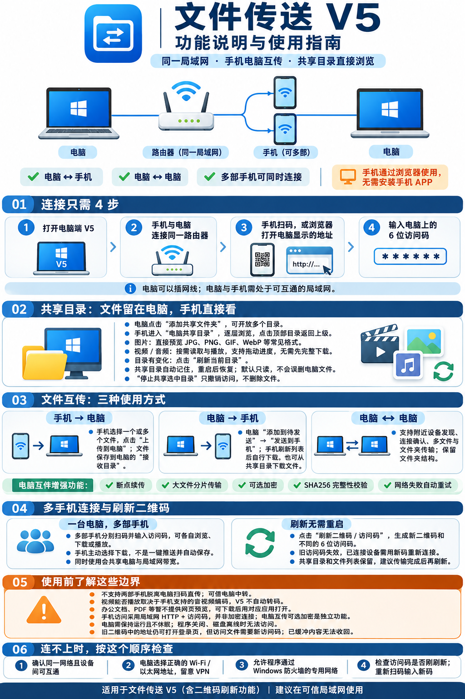

# 文件传送 V5

**不用配置 Windows 文件共享，手机扫码即可浏览电脑共享目录、查看图片、播放兼容的音视频，也能双向传文件。**

Windows 桌面端 + 手机浏览器，面向可信局域网使用。手机无需安装专用 APP。



## 功能一览

| 功能 | 说明 |
| --- | --- |
| 扫码连接 | 电脑显示二维码和 6 位访问码，手机浏览器连接 |
| 刷新二维码与访问码 | 无需重启；生成新码并清除来访连接状态 |
| 共享目录浏览 | 可添加多个目录，浏览子目录，默认只读，配置自动保存 |
| 图片与音视频 | 常见图片直接预览，兼容的媒体按需读取，视频支持进度拖动 |
| 手机传电脑 | 多文件上传到电脑的接收目录 |
| 电脑传手机 | 发布待发送文件，由手机选择下载，也可下载共享目录中的文件 |
| 多手机访问 | 多部手机分别连接、浏览、下载或播放，共享网络带宽 |
| 电脑互传 | 附近设备发现、手动连接、多文件和文件夹传输、保留目录结构 |
| 电脑互传增强 | 断点续传、可选加密、SHA256 校验、网络失败自动重试 |

## 快速开始：Windows 成品

在本仓库发布了 Releases 后，可从 Releases 下载 `文件传送V5.exe`。源码仓库不包含 EXE。

1. 打开电脑端，选择正确的 Wi-Fi / 以太网地址。
2. 手机与电脑连接同一路由器；电脑插网线也可以，设备之间需要可互通。
3. 手机扫码，或在浏览器输入窗口显示的地址，再输入 6 位访问码。
4. 电脑点击“添加共享文件夹”，手机进入“电脑共享目录”即可浏览。
5. 需要传文件时，使用手机上传区或电脑的“添加到待发送”→“发送到手机”。

更多操作见 [V5 使用说明](V5使用说明.md)。同一电脑建议只运行一个版本。

## 从源码运行

当前开发和打包环境为 Windows 10、Python 3.9.13；其他系统未验证。依赖文件记录当前环境的直接依赖版本，不代表跨平台兼容承诺，也不是完整的传递依赖锁文件。

在项目根目录打开 PowerShell：

```powershell
python -m venv .venv
.\.venv\Scripts\python.exe -m pip install -r requirements.txt
.\.venv\Scripts\python.exe main.py
```

使用包含 Tkinter 的 Windows Python 安装。拖拽支持为可选能力；不安装 `tkinterdnd2` 仍可通过按钮选择文件。

## 打包 Windows EXE

```powershell
.\.venv\Scripts\python.exe -m pip install -r requirements-build.txt
.\.venv\Scripts\python.exe -m PyInstaller --noconfirm LanTransfer.spec
```

输出：`dist/文件传送V5.exe`。构建目录和成品不提交到源码仓库，EXE 作为 Release 附件发布。

## 使用范围与限制

- 仅面向可信局域网，不支持开箱即用的公网远程访问，也不要把服务端口映射到公网。
- 手机页面使用 HTTP 和访问码，流量没有 HTTPS 保护。电脑互传的“可选加密”是独立功能，不代表手机流量加密，也不代表已完成安全审计。
- 视频播放取决于手机浏览器及音视频编码；不提供自动转码。办公文档、PDF 等提供下载，不提供内嵌预览。
- 不支持手机脱离电脑扫码直传；可以借电脑中转。
- 多手机模式是分别访问和主动下载，不是电脑一键推送并自动保存。
- 默认单文件上传上限为 512 MiB；分片和续传不会取消接收端大小限制。共享视频按需读取不受上传上限约束。
- 刷新访问码不改变局域网地址。旧码不能发起新的受保护请求；已开始的旧式上传、下载可能继续，已缓冲内容不能收回，建议传完后刷新。
- 程序需保持运行，电脑不能休眠；关闭程序或磁盘离线后无法访问。

## 配置与排障

- 默认接收目录：当前用户的 `Downloads/LanTransfer`，可在窗口更改。
- 共享目录配置：`%LOCALAPPDATA%/LanTransferV5/shared-folders.json`。
- 首选 HTTP 端口：8765；实际地址以窗口显示为准。
- 电脑发现使用 UDP 47865；发现失败时可手动输入对方地址。
- 连不上时检查同网互通、访客 Wi-Fi 隔离、VPN、Windows 防火墙的专用网络权限，以及访问码是否刷新。
- 问题反馈请注明 Windows 版本、手机系统和浏览器、操作步骤与报错。不要提交真实访问码、私人文件或包含私人路径的配置。

## 项目结构

```text
main.py               程序入口
 desktop_app.py       桌面窗口、连接和共享目录管理
 server.py            原有传输 HTTP 接口
 transfer_state.py    文件和设备状态
 shared_library.py    只读共享目录与路径范围检查
 media_server.py      目录浏览、HEAD / Range 媒体读取
 web_ui.py            手机传输页面
 library_ui.py        手机共享浏览和预览页面
 remote_client.py     电脑互传客户端
 encryption_utils.py  电脑互传加密
 discovery.py         局域网设备发现
 network_utils.py     网络地址选择
 tests/               回归用例
 docs/                功能图片、发布说明
```

## 测试状态

仓库包含 `unittest` 用例。用户已有个人使用反馈，但本次 GitHub 整理没有运行测试、启动程序或打开浏览器；不要把打包成功等同于全部功能已验证。

开发者需要时可手动执行：

```powershell
.\.venv\Scripts\python.exe -m unittest discover -s tests -v
```

## 发布与授权

发布素材与上传步骤见 [发布指南](docs/PUBLISHING.md)，本版说明见 [V5 发布说明](docs/RELEASE-v5.md)。

当前未添加开源许可证；公开源码和授予开源许可是不同决定，授权方式由作者发布前确定。第三方依赖保持各自的许可条款，见 [依赖说明](DEPENDENCIES.md)。
